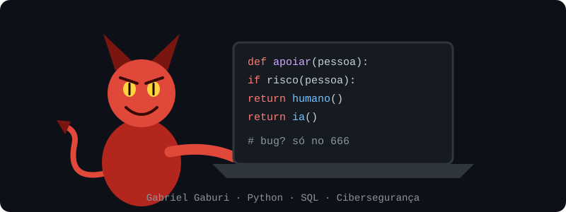

  

# Olá, eu sou o Gabriel 👋

Estudante de **Ciência da Computação** em transição de carreira para tecnologia. Me interesso por desenvolvimento de software, banco de dados e IA, e hoje estudo **cibersegurança**.

🎯 Estou em busca de **estágio, vaga júnior ou suporte**.

## Stack

**Conceitos:** lógica de programação, OLTP/OLAP, data warehouse, business intelligence, ciência de dados.

## Projeto em destaque

### [Apoio & Consciência](https://github.com/GabrielGaburi/site-ajuda-apostas)
Plataforma web de apoio a pessoas afetadas por apostas: chatbot com IA que encaminha para profissionais humanos ao detectar risco, fórum moderado e painéis para usuário, profissional e administrador.

- Auditoria de segurança do próprio projeto: 68 rotas verificadas por perfil e 13 vulnerabilidades corrigidas (condições de corrida no 2FA, redirecionamento aberto, vazamento em exportação de dados e outras).
- Conformidade com a LGPD: consentimento para dados de saúde, exportação e exclusão de conta, retenção automática.
- 46 testes automatizados e módulos independentes de framework.

## Contato

📧 [gabrielgaburi6@gmail.com](mailto:gabrielgaburi6@gmail.com)
